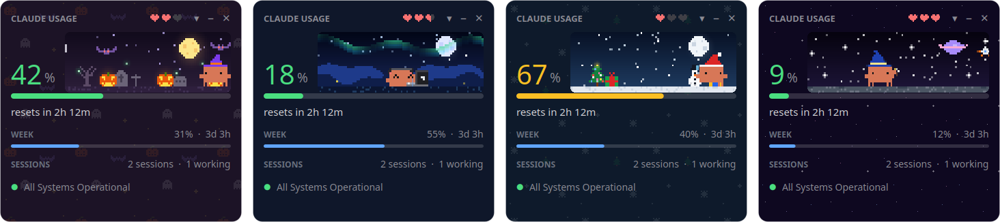

# Clawd Usage for Linux

A small desktop widget that shows how much of your Claude plan limit you've used, with Clawd walking around on top. This version adds themes and outfits. In October Clawd walks through a graveyard full of bats, in December through snow, and you can dress him as a chef, wizard, detective or programmer at any time.



The same Clawd and themes also live in the VS Code sidebar: [clawd-usage-vscode](https://github.com/LaineyLouiseWard/clawd-usage-vscode). Its companion [chatgpt-usage-vscode](https://github.com/LaineyLouiseWard/chatgpt-usage-vscode) shows a ChatGPT plan's limits beside it.

## Built on

This widget is built from three MIT-licensed projects, and the ideas and artwork are theirs.

- [Enhed/clawd-usage-winwidget](https://github.com/Enhed/clawd-usage-winwidget) is the original Windows widget, where the design and Clawd's animations come from.
- [Ivan1Rev/clawd-usage-linux](https://github.com/Ivan1Rev/clawd-usage-linux) is the Python + Qt port that this repo is forked from. It runs on most Linux distros (Debian, Ubuntu, Mint, Fedora, Arch, openSUSE…) and desktops (GNOME, KDE, XFCE, Cinnamon…).
- [YoussefAbdelkawy/Pinch](https://github.com/YoussefAbdelkawy/Pinch) is the Android home-screen widget whose themes, scenes, outfits and outfit routines are ported here from Kotlin.


Unofficial fan project, not made by or affiliated with Anthropic.

## What it shows

- **Session %** for the current 5-hour window, with a bar and time until reset
- **Week %** (and Fable week when your plan has one)
- **Hearts** for Clawd's health: they drop as you use up the session
- Running Claude Code sessions, Claude service status, and stats for the last 24 h / 7 days
- A pixel sky behind Clawd that follows the time of day and your real local weather

**Added in this port:** the card stays a slim bar until you hover over it. Also, under Details (▾) you can switch the big number to **Claude Code**, **Cowork** or **Chat**. Anthropic only reports one combined percentage, so these are *estimates* built from what was active on this PC when the percentage went up (marked with ≈).

## Install

You need [Claude Code](https://docs.claude.com/en/docs/claude-code) installed and logged in. The widget reads its data from `claude /usage`, which uses no tokens.

**1. Install PyQt6** (the Qt library for Python) with your distro's package manager:

| Distro | Command |
|---|---|
| Debian, Ubuntu, Mint, Pop!_OS | `sudo apt install python3-pyqt6` |
| Fedora | `sudo dnf install python3-pyqt6` |
| Arch, Manjaro, EndeavourOS | `sudo pacman -S python-pyqt6` |
| openSUSE | `sudo zypper install python3-PyQt6` |
| Anything else | `pip install --user PyQt6` |

Not sure? Skip this step: `install.sh` checks for PyQt6 and prints the right command for your distro.

**2. Download and install:**

```sh
git clone https://github.com/LaineyLouiseWard/clawd-usage-linux.git
cd clawd-usage-linux
sh install.sh
```

The installer asks whether to start Clawd Usage when you log in. To decide up front, run `sh install.sh --autostart` or `sh install.sh --no-autostart`. You can change your mind later by running it again with the other option.

Then open **Clawd Usage** from your app menu. Everything installs to your home folder; no root needed apart from PyQt6.

Needs a desktop session (not a headless server) and a distro recent enough to package PyQt6 (roughly 2021 or newer). Tested on Kubuntu with KDE Plasma 6 on Wayland; other setups are expected to work but haven't been tested - issues welcome.

To remove: `sh uninstall.sh` (add `--all` to delete settings too).

## Using it

- The card sits as a slim bar (percent + hearts). Hover over it or click it and it slides open with all the stats; it closes again a couple of seconds after the mouse leaves. Right-click → *Close after mouse leaves* sets the delay, and *Open on hover* turns this off to keep it open.
- Drag the card to move it. Right-click for the menu (open on hover, always on top, main number, sky & weather, animations, settings file).
- Click Clawd to make him do something.
- `–` hides it to the tray; `✕` quits.
- Settings live in `~/.config/clawd-usage/config.json`.

## Themes and outfits

The 11 themes and 31 outfits come from [Pinch](https://github.com/YoussefAbdelkawy/Pinch) (MIT, see [LICENSE-pinch](LICENSE-pinch)). Each theme has its own animated scene, card colour and background pattern, among them Halloween, Christmas, Midnight, Space and Underwater. The chef flips pancakes, the programmer types, the wizard casts spells and the detective investigates.

- Right-click and choose *Theme*. *Follow the season*, the default, picks Halloween in October, Christmas in December, and so on. *Classic* keeps the live-weather sky.
- Right-click and choose *Outfit* to pick the theme's own outfit, none, or any of the 31.
- The settings file keeps your choices as `theme` and `skin`. Set `showFable`, `showDetailsButton` or `showStamp` to `false` to hide the Fable row, the ▾ button or the time of the last reading.

## Notes

- **GNOME:** the tray icon needs the *AppIndicator* extension. Ubuntu has it already; elsewhere install `gnome-shell-extension-appindicator` (Debian, Fedora, Arch) and enable it in the Extensions app.
- **Wayland:** apps can't place their own windows, so the widget can't remember its position or force itself on top. Drag it where you want it each time, or use your desktop's window rules.
- **Weather:** looks up your rough location from your IP (ipwho.is), then gets weather from Open-Meteo (met.no as a backup). To skip the IP lookup, set `weatherLat` and `weatherLon` in the settings file, or turn the sky off in the menu.

## License

MIT, same as the original. See [LICENSE](LICENSE). The scenes, outfits (`skins/`), patterns (`patterns/`) and their drawing code come from Pinch: see [LICENSE-pinch](LICENSE-pinch).
